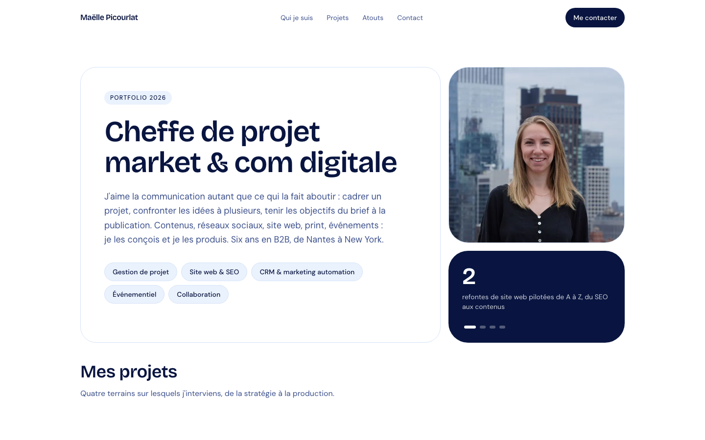

# Portfolio — Maëlle Picourlat

Portfolio de Maëlle Picourlat, cheffe de projet marketing & communication digitale (Nantes) : stratégie digitale, réseaux sociaux, création graphique, site web et événementiel.



## Stack

- [TanStack Start](https://tanstack.com/start) + TanStack Router (SSR)
- React 19, TypeScript
- Tailwind CSS 4, Radix UI / shadcn
- Vite 8, Nitro (serveur Node)
- Bun (lockfile, build Docker)

## Démarrage

```sh
bun install      # ou npm install
bun run dev      # http://localhost:3000 (port Vite par défaut si libre)
```

| Script             | Rôle                              |
| ------------------ | --------------------------------- |
| `bun run dev`      | Serveur de développement          |
| `bun run build`    | Build de production (`.output/`)  |
| `bun run preview`  | Prévisualiser le build            |
| `bun run lint`     | ESLint                            |
| `bun run format`   | Prettier                          |

## Structure

```
src/
  routes/                 # Pages (index.tsx = page unique)
  components/portfolio/   # ProjectGallery + data.ts (projets, atouts, expériences)
  components/ui/          # Composants UI
  assets/                 # Images (webp)
public/                   # favicon, og-image, robots.txt, sitemap.xml
```

Le contenu (projets, expériences, outils) se modifie dans `src/components/portfolio/data.ts`.

## Déploiement

Image Docker multi-étapes (build Bun, exécution Node 22) :

```sh
docker build --build-arg SITE_URL=https://mon-domaine.fr -t maelle-portfolio .
docker run -p 3000:3000 maelle-portfolio
```

`SITE_URL` est injecté au build (`VITE_SITE_URL`) pour les URLs canoniques, Open Graph, `sitemap.xml` et `robots.txt`.

## Mettre à jour la capture d'écran

Avec le serveur de dev lancé :

```sh
"/Applications/Google Chrome.app/Contents/MacOS/Google Chrome" --headless=new \
  --hide-scrollbars --window-size=1440,900 --virtual-time-budget=8000 \
  --screenshot=docs/screenshot.png http://localhost:3000/
```
